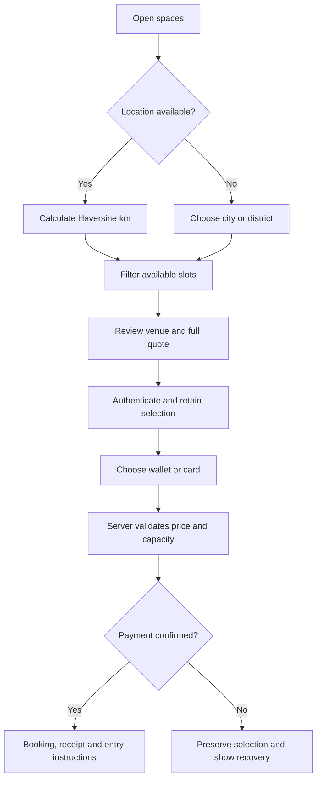
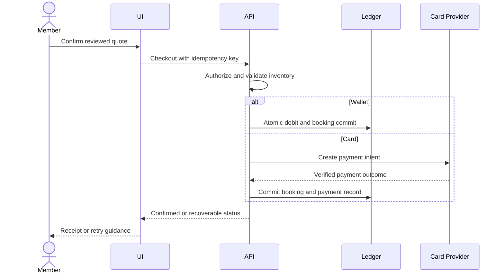
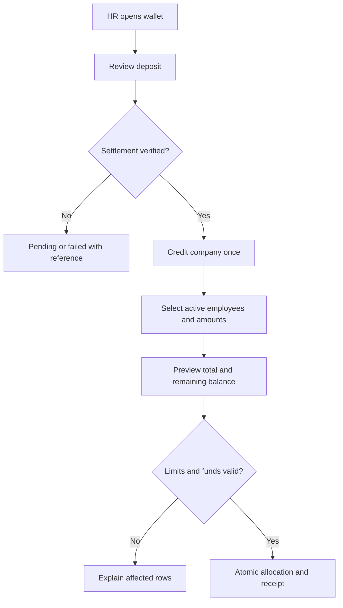
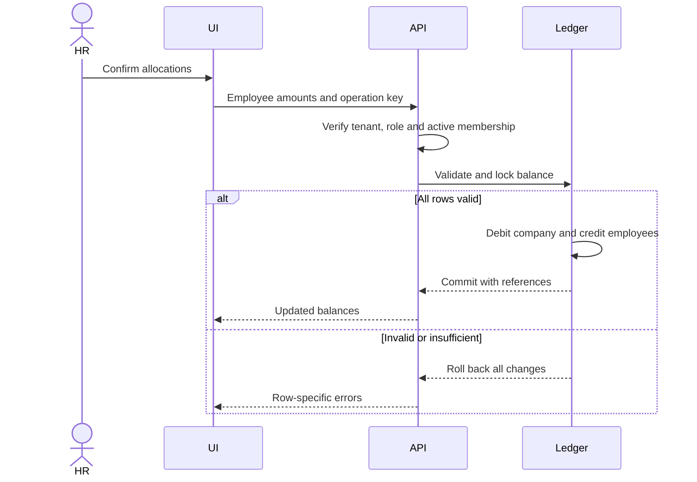
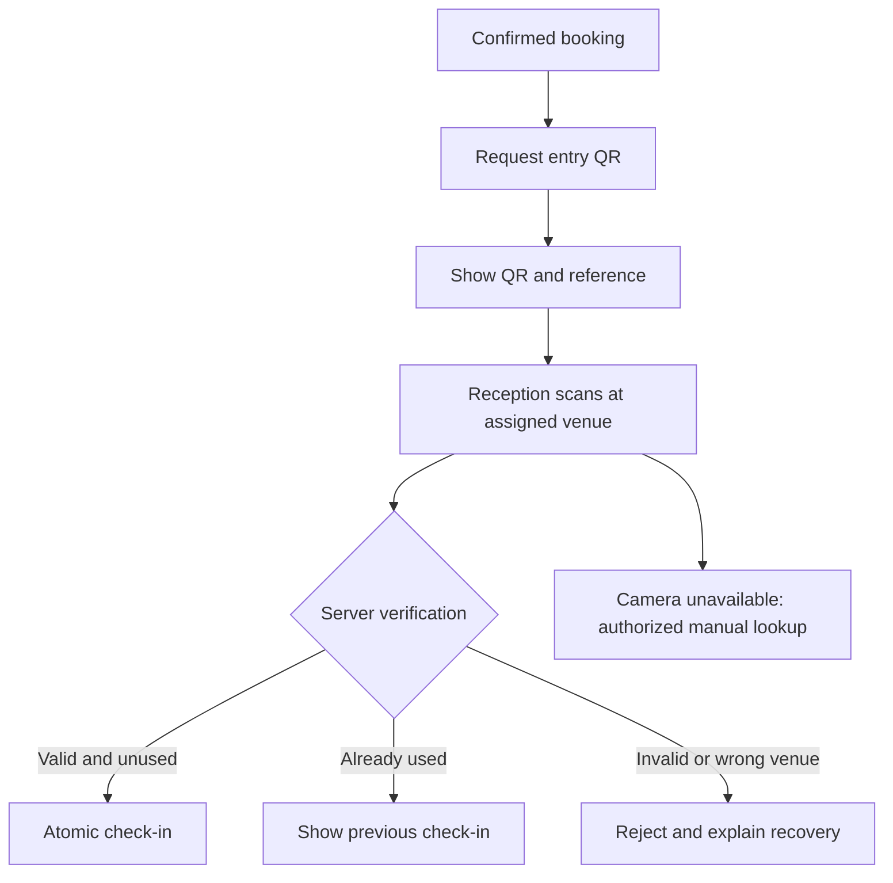
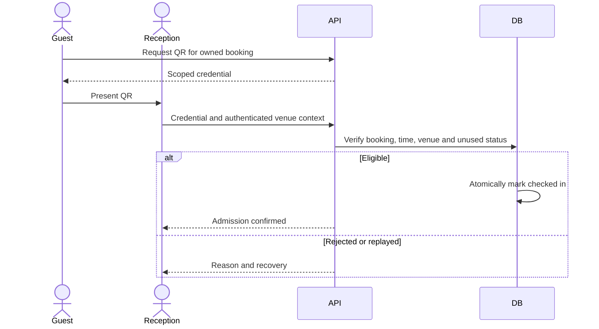
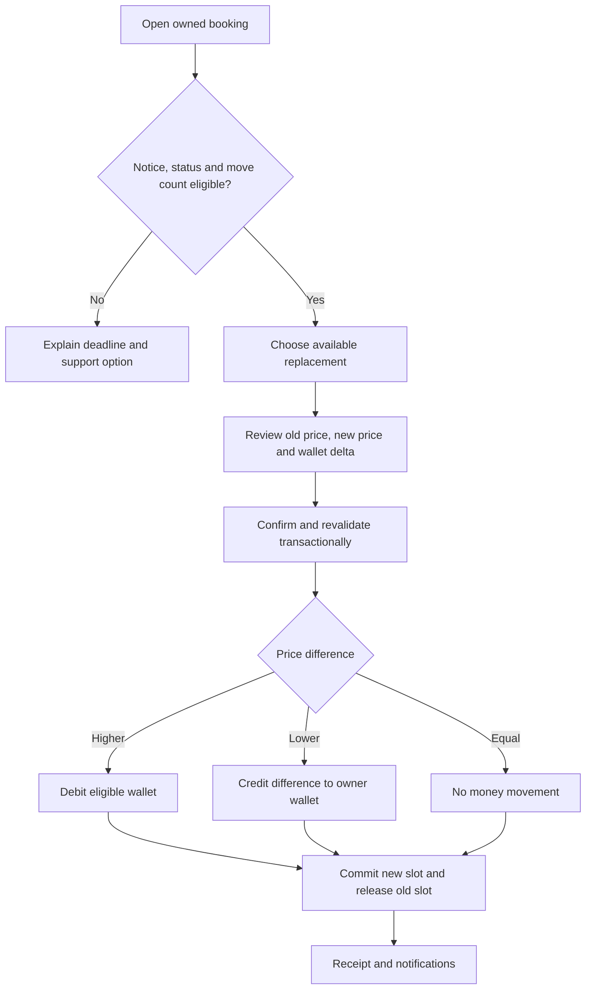
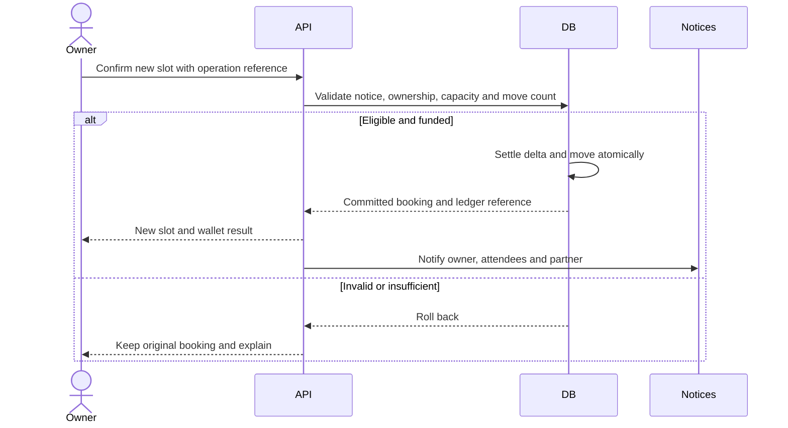

# Muttaka (مُتَّكَأ) — UI/UX Specification

Version 1.0 · 11 November 2026 · Product, Design, Engineering and QA

## 1. Scope and evidence

Provide a bilingual Saudi B2B2C workspace service with predictable navigation, transparent spending and dependable venue entry. Requirements below are production acceptance targets, not a claim that every feature is implemented.

These five personas are realistic design hypotheses using the requested identities, not verified interview subjects. Validate motivations through consented interviews and observed tasks across Riyadh, Jeddah and Al-Khobar, including disabled participants. Do not present these profiles as collected personal data.

Repository evidence: frontend/app/store.tsx owns navigation; frontend/app/globals.css defines the palette; backend/lib/booking/reschedule.ts specifies notice windows, one free move and a 30-day horizon. Server authorization and committed financial outcomes override client estimates. Reception scanning and payment-provider settlement requirements need integration verification before release.

## 2. Saudi personas

### P1 — Fahad Al-Otaibi, 28, Riyadh: freelance full-stack developer

- Context: Independent professional balancing focused coding, client calls and variable income; pays from a personal budget.
- Technology habits: Mobile maps and discovery, laptop comparison and checkout, password manager; Arabic for local information and English for technical work.
- Goals: Find a nearby quiet desk, confirm Wi-Fi and call facilities, understand the final cost before committing.
- Frustrations: Stale availability, hidden fees, lost filters on Back and authentication that erases his selection.
- Journey: Discover → choose district or nearby → compare amenities → inspect slot → authenticate → pay → present QR → retrieve receipt.
- Design response: Stable navigation, explicit availability, complete quotes and recoverable payment status.
- Validation task: Reserve two hours and explain the cancellation deadline without assistance; measure completion and price comprehension.

### P2 — Sarah Al-Qahtani, 36, Jeddah: Head of People & Culture

- Context: Manages 25 hybrid employees, monthly funding and finance reconciliation while protecting employee privacy.
- Technology habits: Desktop spreadsheets and dashboards; mobile approvals between meetings; bilingual reports.
- Goals: Deposit corporate funds, allocate fairly, set limits and distinguish available funds from allocated or spent money.
- Frustrations: Ambiguous ledger labels, duplicate deposits, manual reconciliation and bulk actions with unclear outcomes.
- Journey: Review wallet → deposit → await settlement → select employees → preview allocation → confirm → reconcile.
- Design response: Separate available, allocated and spent values; atomic transfers; traceable references and actionable row errors.
- Validation task: Fund all 25 employees and explain resulting balances without external arithmetic.

### P3 — Khalid Al-Ghamdi, 42, Al-Khobar: space operations partner

- Context: Operates desks and meeting rooms, coordinates reception shifts and handles peak arrivals.
- Technology habits: Desktop inventory management and shared reception tablet; practical rather than technically specialized.
- Goals: Maintain accurate capacity, admit eligible guests quickly and resolve duplicate scans without confrontation.
- Frustrations: Overbooking, reused QR screenshots, vague rejection messages and cancellations that leave inventory blocked.
- Journey: Review roster → maintain availability → open scanner → validate guest → admit → reconcile occupancy.
- Design response: Venue-scoped permissions, clear scan states, authorized manual lookup and audit trails.
- Validation task: Process valid, expired, duplicate and wrong-venue codes and explain each result accurately.

### P4 — Noura Al-Subaie, 26, Riyadh: remote corporate UI/UX designer

- Context: Uses an employer-funded allowance for focused work and occasional team collaboration.
- Technology habits: Mobile discovery, laptop design tools, frequent Arabic/English switching.
- Goals: Understand allowance and spending rules, find suitable facilities and adjust plans when meetings change.
- Frustrations: Corporate and personal balances conflated, restrictions revealed late, overlapping form icons and unclear refunds.
- Journey: Join company → inspect allowance → discover → book → reschedule → verify wallet difference → check in.
- Design response: Funding-source explanation, remaining allowance, readable mixed-direction fields and explicit refund destination.
- Validation task: Explain which funds pay and where a cheaper replacement booking returns the difference.

### P5 — Sultan Al-Harbi, 39, Riyadh: platform operations director

- Context: Oversees partner quality, payment disputes, account restrictions and service incidents across tenants.
- Technology habits: Desktop dashboards, filtered exports and operational logs; mobile triage for urgent exceptions.
- Goals: Trace financial events, identify exceptions and make authorized corrections with a reason.
- Frustrations: Inconsistent booking states, untraceable manual changes and success messages preceding server commits.
- Journey: Review exceptions → filter tenant/date → inspect booking and ledger → correct with reason → verify outcome.
- Design response: Stable references, least-privilege views, audited changes and retry-safe actions.
- Validation task: Resolve a duplicate-refund report from one reference and explain the supporting evidence.

## 3. Navigation contract

Public destinations: /, /spaces, /auth, /auth/register, /pricing and /contact. Personal dashboard: /dashboard; organization, partner and admin areas have role-specific routes. Centralize screen/path mappings.

User navigation adds one history entry. Back/Forward restores state without pushing. Mount reads the pathname after a server-compatible initial render. Direct requests and refreshes resolve to the application shell. History can retain ephemeral parameters, never passwords, payment instruments or authentication tokens.

Entity deep links require stable identifiers and server lookup; a screen path alone is not a complete venue or booking link. Missing identifiers require a recovery action. A URL grants no authorization. Unauthenticated private routes require sign-in; wrong-role routes require a safe destination. Unknown routes need a useful not-found state. Dashboard aliases must respect the authenticated role.

## 4. Concrete flows

### Flow A — Discovery, proximity and instant checkout

Request location only after a nearby action. Denial offers city/district search. Haversine uses radians and radius 6371 km: a = sin²(Δlat/2) + cos(lat1)cos(lat2)sin²(Δlon/2); d = 2R atan2(√a, √(1−a)). Clamp a to [0,1], validate coordinates and preserve zero coordinates. Sort by unrounded distance with stable ID tie-breaking; unknown distances sort last. Display rounded straight-line km, never travel time.

A payment timeout means pending/unknown, not paid or failed. Query the original operation before retrying. If payment succeeds but inventory cannot commit, reconcile or compensate visibly. Do not represent mock card processing as production integration.

### Flow B — Corporate deposit and employee allocation

Only authorized tenant HR administrators deposit or allocate. Show available company balance, outstanding allocations and spend separately. A pending deposit is unavailable until verified settlement. Allocation is an internal transfer, not another deposit.

No negative balances. Duplicate submissions return the original outcome. Reconcile opening + deposits − allocations + returns − direct company spend = closing. Spending already-allocated funds must not debit the company twice. Batch atomicity is a target requirement requiring API verification.

### Flow C — Entry QR and reception verification

Generate credentials only for authorized confirmed bookings. Target QR content is opaque and scoped, with no phone, email or payment data. Reception sees only admission-relevant information. Configure expiry, entry window and re-entry policy before production rollout.

Offline scanning never displays verified admission. Offer reconnect or manual assistance. Concurrent scans produce one successful transition. Manual lookup requires equivalent authorization and an audit record.

### Flow D — Rescheduling and instant wallet refunds

Current server helper policy: B2C-owned bookings require 6 hours' notice; other owner roles require 24 hours. An employee booking with allocated funds follows the stored owner role, not simply the funding source. One free reschedule; replacement at most 30 days after the original date. Owner or Super Admin initiates; attendees only view. Verify exact boundary semantics against endpoint tests.

A cheaper move refunds only the difference. Cancellation is separate and quotes its eligible refund before confirmation. HR-owned refunds go to the company wallet; others follow the server's personal-wallet result. Instant means available after ledger commit, not immediate card-network settlement. Notification failure must not reverse the financial transaction.

## 5. User stories and acceptance criteria

| ID | Story | Given / When / Then |
|---|---|---|
| US01 | As a visitor, I want shareable screen URLs so that I can return to my task. | Given /auth, when opened directly or refreshed, then login appears; given spaces then pricing, when Back/Forward runs, then URL and screen agree without duplicate entries. |
| US02 | As Fahad, I want nearby results so that I can choose a convenient venue. | Given valid coordinates, when sorting, then unrounded Haversine distance orders results; given denied location, when continuing, then city search remains available. |
| US03 | As Fahad, I want a full quote so that I can control spending. | Given a slot, when reviewing checkout, then currency, duration, fees, total and deadline appear before confirmation; unavailable inventory prevents charging. |
| US04 | As a member, I want retry-safe payment so that a timeout cannot charge me twice. | Given one operation key, when submitted twice, then one charge and booking commit; pending status never shows a confirmed receipt. |
| US05 | As Sarah, I want verified deposits so that budgets use settled money. | Given a pending deposit, when refreshed, then available balance is unchanged; when settlement arrives twice, then only one credit exists. |
| US06 | As Sarah, I want batch allocation so that I can fund 25 colleagues efficiently. | Given valid employees and funds, when confirmed, then company debit equals employee credits; given one invalid row, then the atomic batch changes nothing and identifies the row. |
| US07 | As Noura, I want funding clarity so that I can obey company policy. | Given personal and allocated funds, when reviewing payment, then source and limits appear; a rejected limit leaves booking and balances unchanged. |
| US08 | As Khalid, I want reliable reception scanning so that only eligible guests enter. | Given one valid credential, when scanned concurrently twice, then one check-in succeeds; expired or wrong-venue credentials never admit. |
| US09 | As a receptionist, I want camera fallback so that I can assist guests. | Given camera denial, when manual lookup is selected, then authenticated venue-scoped verification is available and audited. |
| US10 | As Noura, I want eligible rescheduling so that changed plans do not waste bookings. | Given an eligible B2C booking outside 6 hours, when a valid move is confirmed, then one move commits; inside the window or after the allowed move, then the original stays unchanged. Repeat for the 24-hour policy. |
| US11 | As Sarah, I want accurate refunds so that company funds reconcile. | Given a cheaper HR-owned move, when committed, then only the difference credits the company wallet once; repeats create no extra refund. |
| US12 | As Sultan, I want an audit trail so that I can resolve disputes. | Given an authorized correction, when confirmed with a reason, then actor, time, entity and financial references are recorded; another tenant cannot read them. |
| US13 | As an Arabic-speaking member, I want readable fields so that I can enter credentials accurately. | Given RTL and long email text, when typing or revealing a password, then icons never cover text and the caret remains usable; labels retain RTL alignment. |
| US14 | As a keyboard user, I want keyboard operation so that I can book independently. | Given no pointing device, when completing discovery through confirmation, then focus is visible, ordered, untrapped and restored after dialogs. |

## 6. Design system and localization

Brand: مُتَّكَأ / Muttaka conveys calm hospitality and professional control. Use restrained surfaces, generous spacing and concrete action labels. Financial decisions prioritize legibility over decoration.

| Token | Value | Use |
|---|---|---|
| plaster | #F7F5F0 | Canvas |
| plaster-surface | #FDFCFA | Cards and fields |
| soot | #18181B | Primary text and strong actions |
| soot-light | #52525B | Secondary text |
| moss | #56615A | Supporting labels |
| eucalyptus | #8FB5A0 | Decoration, not small text on light backgrounds |
| accent | #047857 | Actions and focus |
| mist | #B3C9D6 | Information background |

Typography: Tajawal Arabic, Geist Latin, system fallback. Targets: body 16px/1.6; labels 14px; headings 28–40px responsive. No Arabic letter spacing or forced uppercase. Spacing uses a 4px base, field radius 12px and card radius 24px. Internal usability target: critical controls at least 44×44 CSS pixels.

Forms: Persistent associated labels, semantic required state, adjacent errors linked with aria-describedby and aria-invalid. Preserve entries after errors. Two-icon fields reserve 48px physical gutters regardless of direction. Email/phone are LTR; password direction stays stable when revealed. Eye toggles are named non-submit buttons exposing state. Decorative icons are hidden from assistive technology.

Mirror layouts, navigation arrows and logical margins, but not logos, QR codes, media controls, email or phone numbers. Isolate mixed-direction fragments with bdi. Use locale-aware SAR formatting and explicit Asia/Riyadh times. Labels and helper text follow document direction.

Validate 320, 390, 768, 1024 and 1440px widths. Sticky checkout actions must not obscure content. Tables retain meaningful headers and controlled overflow; critical summaries reflow. Distinguish loading, empty, failed, pending and successful states. Never announce skeletons as real content.

## 7. Accessibility acceptance

Target WCAG 2.1 AA for complete journeys, including dialogs and payment; compliance requires an audit, not a build result. Normative reference: [W3C WCAG 2.1](https://www.w3.org/TR/WCAG21/).

Text contrast: 4.5:1, or 3:1 for qualifying large text. Essential controls and graphics: 3:1. Require keyboard access, visible focus, meaningful structure, programmatic labels, language identification and announced status updates. Text resizing to 200% and reflow at 320 CSS pixels preserve functionality. Do not rely on color alone. Avoid unexpected context changes and provide review/correction before financial confirmation. Record evidence for each applicable criterion.

Product additions: honor reduced motion, provide map list alternatives and reservation text beside QR codes. Test VoiceOver/Safari, NVDA/Chrome, keyboard, zoom, contrast and orientation. Automated scans supplement manual journeys.

## 8. Release gates and measurement

- Engineering: build and unit tests pass; runtime browser checks show no hydration errors. Test direct routes, refresh, Back/Forward, role restrictions and missing-entity recovery. Build alone cannot prove runtime hydration correctness.
- QA: Arabic/English, autofill, long inputs, reveal/hide, zoom and icon geometry. Exercise just before/at/after 6-hour and 24-hour boundaries, simultaneous inventory changes, double scans and duplicate payments.
- Design: approve locale screenshots, comprehensible errors and price review. Product: validate personas and confirm entry/re-entry policy. Operations: assign reconciliation and incident owners before production payments.
- Analytics: discovery started, quote viewed, checkout resolved, allocation resolved, scan resolved and reschedule resolved. Capture categorical failures and operation references, never credentials, QR tokens or precise user coordinates. Segment by role and locale; establish baselines before conversion targets.
- Release invariants: zero duplicate financial effects and zero unauthorized admissions. Money, permission and deadline changes require Product, Engineering and QA review with matching updates to both languages.
