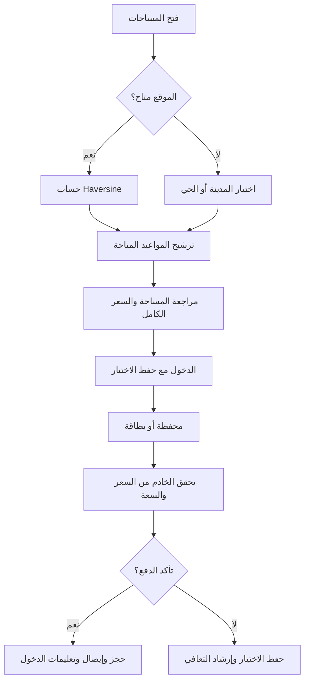
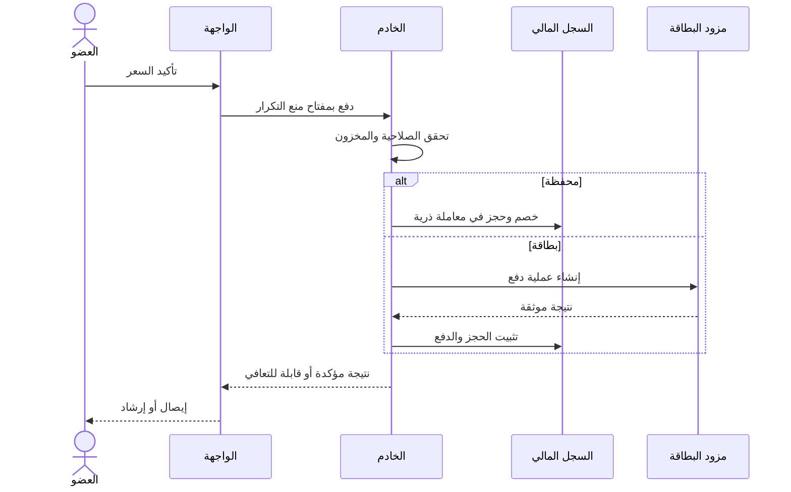
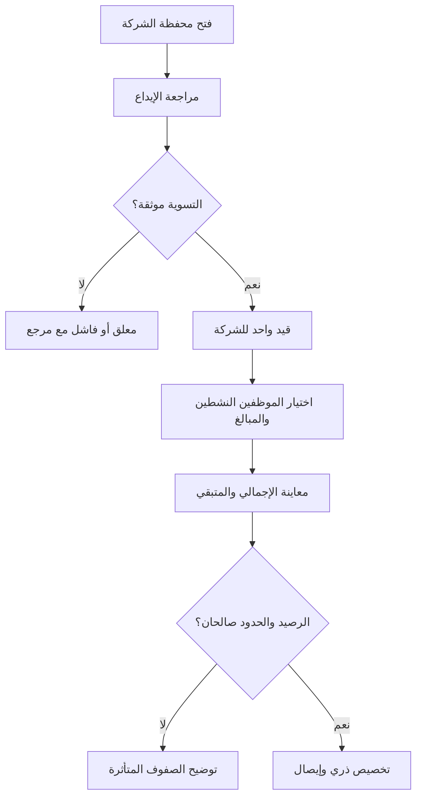
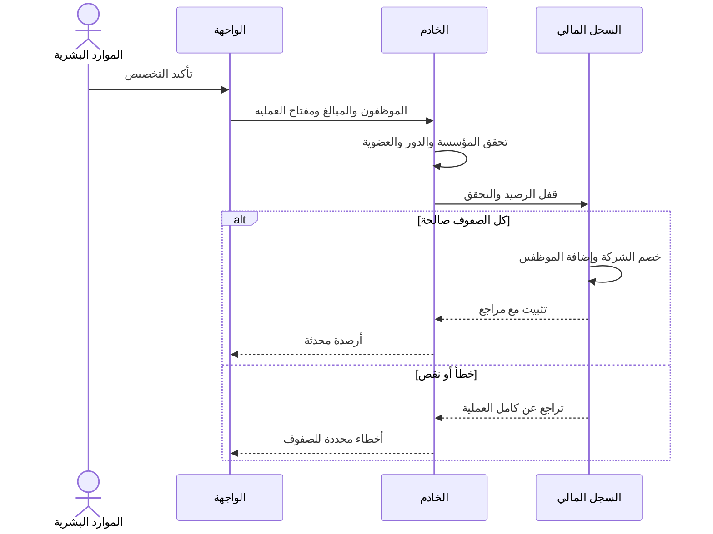
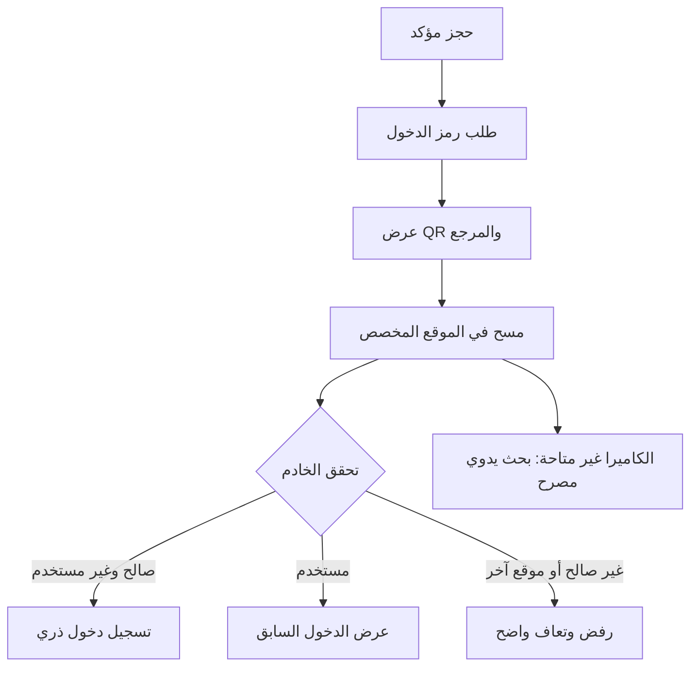
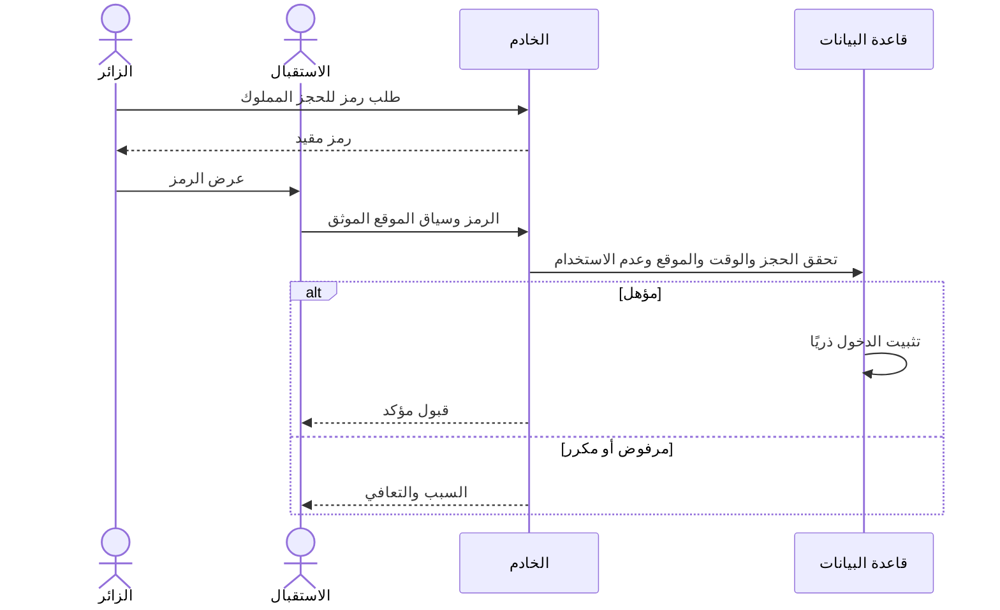
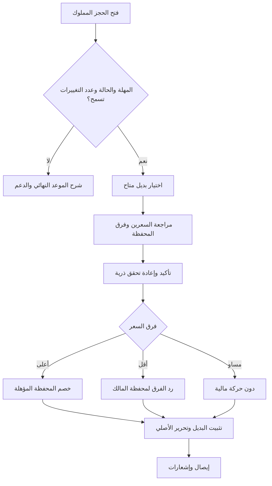
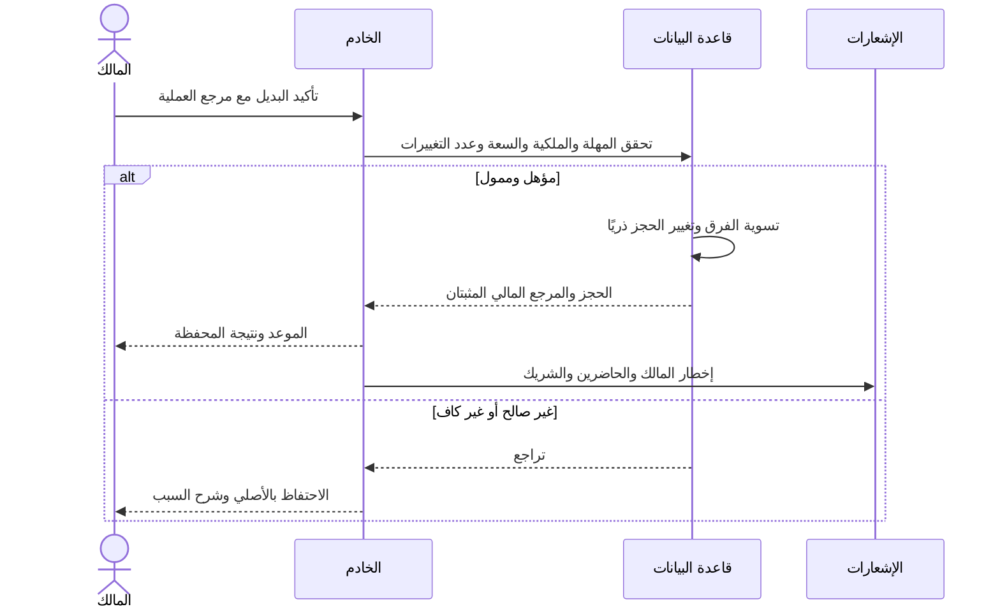

# مُتَّكَأ — مواصفات واجهة المستخدم وتجربته

الإصدار 1.0 · 11 نوفمبر 2026 · فرق المنتج والتصميم والهندسة وضمان الجودة

## 1. النطاق ومصادر المعلومات

منصة سعودية ثنائية اللغة لحجز مساحات العمل للأفراد والشركات وشركاء التشغيل، بتصفح متوقع وإنفاق واضح ودخول موثوق للمواقع. هذه المواصفات تحدد معايير القبول الإنتاجية، ولا تعني أن جميع القدرات مطبقة حاليًا.

الشخصيات الخمس فرضيات تصميم واقعية بالأسماء المطلوبة، وليست أشخاصًا تمت مقابلتهم أو بيانات بحث ميداني موثقة. تُختبر الدوافع بمقابلات بموافقة المشاركين وملاحظة المهام في الرياض وجدة والخبر، مع إشراك مستخدمين ذوي إعاقة.

يعتمد التصفح على frontend/app/store.tsx، والألوان على frontend/app/globals.css. يحدد backend/lib/booking/reschedule.ts فترات الإشعار وتغييرًا مجانيًا واحدًا وأفقًا قدره 30 يومًا. صلاحيات الخادم ونتائج المعاملات المثبتة تتقدم على تقديرات الواجهة. استقبال الزوار عبر QR وتسوية مزود الدفع متطلبات مستهدفة تحتاج تحققًا تكامليًا.

## 2. الشخصيات السعودية

### P1 — فهد العتيبي، 28 عامًا، الرياض: مطور مستقل متكامل

- السياق: يوازن بين البرمجة المركزة ومكالمات العملاء ودخل شهري متغير؛ يدفع من ميزانيته الشخصية.
- العادات التقنية: الخرائط والاكتشاف بالجوال، والمقارنة بالحاسب، ومدير كلمات مرور؛ العربية للمعلومات المحلية والإنجليزية للعمل التقني.
- الأهداف: مكتب هادئ قريب، اتصال موثوق ومكان للمكالمات، ومعرفة السعر الكامل قبل الالتزام.
- الإحباطات: توافر قديم، رسوم مفاجئة، فقد المرشحات عند الرجوع وفقد الاختيار بعد تسجيل الدخول.
- الرحلة: اكتشاف ← تحديد الحي أو القرب ← مقارنة المرافق ← اختيار الموعد ← دخول ← دفع ← عرض QR ← إيصال.
- الاستجابة التصميمية: تنقل ثابت، توافر واضح، عرض سعر كامل وحالة دفع قابلة للاستعادة.
- مهمة التحقق: حجز ساعتين وشرح مهلة الإلغاء دون مساعدة؛ قياس الإنجاز وفهم السعر.

### P2 — سارة القحطاني، 36 عامًا، جدة: رئيسة الأفراد والثقافة

- السياق: تدير 25 موظفًا بنمط هجين وتمويلهم الشهري والمطابقة المالية مع حماية خصوصيتهم.
- العادات التقنية: الجداول ولوحات التحكم بالحاسب والموافقات بالجوال وتقارير ثنائية اللغة.
- الأهداف: شحن محفظة الشركة، توزيع عادل، ضبط الحدود والتمييز بين المتاح والمخصص والمنفق.
- الإحباطات: أوصاف دفتر أستاذ مبهمة، إيداعات مكررة، مطابقة يدوية ونتائج جماعية غير واضحة.
- الرحلة: مراجعة المحفظة ← إيداع ← انتظار التسوية ← تحديد الموظفين ← معاينة التخصيص ← تأكيد ← مطابقة.
- الاستجابة التصميمية: أرصدة منفصلة، تحويلات ذرية، مراجع قابلة للتتبع وأخطاء محددة لكل صف.
- مهمة التحقق: تمويل الموظفين الخمسة والعشرين وشرح الأرصدة الناتجة دون حسابات خارجية.

### P3 — خالد الغامدي، 42 عامًا، الخبر: شريك تشغيل المساحة

- السياق: يشغل المكاتب وغرف الاجتماعات وينسق مناوبات الاستقبال ويتعامل مع ذروة الوصول.
- العادات التقنية: إدارة المخزون بالحاسب وجهاز لوحي مشترك للاستقبال؛ استخدام عملي غير تخصصي.
- الأهداف: سعة دقيقة، دخول سريع للمستحقين ومعالجة التكرار دون إحراج الزائر.
- الإحباطات: تجاوز السعة، إعادة استخدام صور QR، رفض غامض وإلغاءات لا تحرر المخزون.
- الرحلة: قائمة اليوم ← تحديث التوافر ← فتح الماسح ← التحقق ← السماح بالدخول ← مطابقة الإشغال.
- الاستجابة التصميمية: صلاحيات مرتبطة بالموقع، حالات مسح واضحة، بحث يدوي مصرح وسجل تدقيق.
- مهمة التحقق: تفسير نتائج رمز صالح ومنتهٍ ومكرر وتابع لموقع آخر بدقة.

### P4 — نورة السبيعي، 26 عامًا، الرياض: مصممة واجهات وتجربة مستخدم عن بعد

- السياق: تستخدم مخصص الشركة للعمل المركز والتعاون الدوري مع الفريق.
- العادات التقنية: اكتشاف بالجوال وأدوات التصميم بالحاسب وتبديل متكرر بين العربية والإنجليزية.
- الأهداف: فهم المخصص وسياسة الصرف واختيار المرافق المناسبة وتعديل الحجز عند تغير الاجتماعات.
- الإحباطات: خلط الأموال الشخصية والمؤسسية، ظهور القيود متأخرًا، تداخل الأيقونات وغموض الاسترداد.
- الرحلة: الانضمام للشركة ← مراجعة المخصص ← اكتشاف ← حجز ← إعادة جدولة ← مراجعة فرق المحفظة ← دخول.
- الاستجابة التصميمية: توضيح مصدر التمويل والمتبقي وحقول سليمة الاتجاه ووجهة استرداد صريحة.
- مهمة التحقق: شرح مصدر الدفع ووجهة الفرق عند الانتقال لحجز أقل سعرًا.

### P5 — سلطان الحربي، 39 عامًا، الرياض: مدير عمليات المنصة

- السياق: يشرف على جودة الشركاء والنزاعات المالية والقيود والحوادث عبر المؤسسات.
- العادات التقنية: لوحات وتقارير وسجلات تشغيل بالحاسب، وفرز الحالات العاجلة بالجوال.
- الأهداف: تتبع الحركة المالية واكتشاف الاستثناءات وإجراء تصحيح مصرح مع سبب.
- الإحباطات: حالات حجز متناقضة وتعديلات غير قابلة للتتبع ونجاح ظاهر قبل تثبيت الخادم.
- الرحلة: الاستثناءات ← ترشيح المؤسسة والتاريخ ← فحص الحجز والسجل المالي ← تصحيح بسبب ← تحقق.
- الاستجابة التصميمية: مراجع ثابتة، أقل قدر من الصلاحيات، تدقيق وإجراءات آمنة عند التكرار.
- مهمة التحقق: حل بلاغ استرداد مكرر من مرجع واحد وشرح الأدلة.

## 3. عقد التصفح

المسارات العامة: / و/spaces و/auth و/auth/register و/pricing و/contact. لوحة الفرد /dashboard، مع مسارات مستقلة للشركة والشريك والإدارة. تُدار الخريطة في مصدر مركزي.

تنقل المستخدم ينشئ عنصر سجل واحدًا. الرجوع والتقدم يستعيدان الشاشة دون إضافة عناصر. بعد العرض الأول المتوافق مع الخادم، تُقرأ pathname. الروابط المباشرة والتحديث يصلان إلى غلاف التطبيق. يمكن حفظ معاملات مؤقتة في السجل، دون كلمات مرور أو رموز مصادقة أو بيانات أدوات الدفع.

روابط الكيانات تحتاج معرفًا ثابتًا واستعلام خادم؛ اسم الشاشة وحده ليس رابطًا كاملًا لحجز أو مساحة. عند غياب المعرف تظهر وسيلة تعافٍ. الرابط لا يمنح صلاحيات. الوجهات الخاصة تتطلب الدخول، والدور غير المناسب يحصل على وجهة آمنة. للمسار المجهول حالة واضحة، وتراعي لوحة التحكم دور المستخدم.

## 4. التدفقات التفصيلية

### التدفق A — الاكتشاف والقرب والدفع الفوري

يُطلب الموقع بعد إجراء صريح للبحث القريب. عند الرفض يتاح اختيار المدينة أو الحي. تستخدم Haversine الزوايا بالراديان ونصف قطر 6371 كم: a = sin²(Δlat/2) + cos(lat1)cos(lat2)sin²(Δlon/2)، ثم d = 2R atan2(√a, √(1−a)). تُحصر a بين صفر وواحد وتتحقق حدود الإحداثيات مع قبول الصفر. الترتيب بالمسافة غير المقربة ثم المعرف الثابت، والمجهول أخيرًا. المعروض مسافة خط مستقيم بالكيلومتر وليس زمن القيادة.

انتهاء مهلة الدفع يعني حالة معلقة أو مجهولة، لا نجاحًا ولا فشلًا مؤكدًا. يُستعلم عن العملية الأصلية قبل إعادة المحاولة. نجاح الدفع مع تعذر تثبيت المخزون يحتاج مطابقة أو تعويضًا واضحًا. الدفع التجريبي لا يُقدم كتكامل إنتاجي.

### التدفق B — إيداع الشركة وتخصيص أموال الموظفين

الإيداع والتخصيص لمدير الموارد البشرية المصرح داخل مؤسسته. تُفصل الأموال المتاحة والمخصصات القائمة والإنفاق. الإيداع المعلق غير متاح حتى التحقق من التسوية. التخصيص تحويل داخلي وليس إيداعًا جديدًا.

لا أرصدة سالبة، والطلب المكرر يعيد النتيجة الأصلية. المطابقة: افتتاحي + إيداعات − تخصيصات + مرتجعات − إنفاق مباشر للشركة = ختامي. إنفاق المال المخصص لا يخصم الشركة مرة أخرى. ذرية التخصيص الجماعي متطلب مستهدف يحتاج تحققًا من الواجهة البرمجية.

### التدفق C — توليد QR والتحقق في الاستقبال

تُصدر بيانات الدخول للحجز المؤكد والمصرح فقط. المحتوى المستهدف رمز مبهم ومقيد دون بريد أو هاتف أو معلومات دفع. يرى الاستقبال بيانات القبول الضرورية فقط. يجب اعتماد مدة الصلاحية ونافذة الدخول وسياسة إعادة الدخول قبل الإطلاق.

دون اتصال لا يظهر قبول موثق. يُعرض إعادة الاتصال أو المساعدة اليدوية. المسح المتزامن ينتج انتقالًا ناجحًا واحدًا. البحث اليدوي يخضع للصلاحية نفسها والتدقيق.

### التدفق D — إعادة الجدولة والاسترداد الفوري للمحفظة

سياسة مساعد الخادم الحالي: 6 ساعات للحجز المملوك لدور B2C و24 ساعة لبقية أدوار المالك. حجز الموظف الممول من المخصص يتبع دوره المخزن، لا مصدر المال وحده. تغيير مجاني واحد، والموعد الجديد لا يتجاوز 30 يومًا بعد الأصلي. يبدأ المالك أو المشرف العام؛ الحاضر يشاهد فقط. تُتحقق الحدود الزمنية الدقيقة باختبارات نقاط النهاية.

البديل الأرخص يعيد الفرق فقط. الإلغاء إجراء مستقل يعرض المبلغ المستحق قبل التأكيد. استرداد حجز الموارد البشرية يعود لمحفظة الشركة؛ البقية وفق نتيجة المحفظة الشخصية من الخادم. الفوري يعني الإتاحة بعد تثبيت القيد، لا وعدًا بتسوية فورية لشبكة البطاقة. فشل الإشعار لا يعكس المعاملة المالية.

## 5. قصص المستخدم ومعايير القبول

الصيغة العربية المكافئة: «بصفتي [الدور]، أريد [القدرة] لكي [الفائدة]». معايير «بفرض / عندما / فإن» تقابل Given / When / Then.

| المعرف | القصة | بفرض / عندما / فإن |
|---|---|---|
| US01 | بصفتي زائرًا، أريد روابط قابلة للمشاركة لكي أعود لمهمتي. | بفرض /auth، عندما يفتح مباشرة أو يحدث، فإن الدخول يظهر؛ وبفرض المساحات ثم الأسعار، عندما أرجع وأتقدم، فإن الرابط والشاشة يتطابقان دون تكرار السجل. |
| US02 | بصفتي فهدًا، أريد نتائج قريبة لكي أختار موقعًا ملائمًا. | بفرض إحداثيات صالحة، عندما ترتب، فإن المسافة غير المقربة تحدد الترتيب؛ وعند رفض الموقع يبقى بحث المدينة متاحًا. |
| US03 | بصفتي فهدًا، أريد سعرًا كاملًا لكي أضبط الإنفاق. | بفرض موعد، عندما أراجع الدفع، فإن العملة والمدة والرسوم والإجمالي والمهلة تظهر قبل التأكيد، وانعدام السعة يمنع الخصم. |
| US04 | بصفتي عضوًا، أريد دفعًا آمن التكرار لكي لا أخصم مرتين. | بفرض مفتاح عملية واحد، عندما يرسل مرتين، فإن خصمًا وحجزًا واحدًا يثبتان؛ المعلق لا يعرض إيصالًا مؤكدًا. |
| US05 | بصفتي سارة، أريد إيداعات موثقة لكي تستخدم الميزانية أموالًا مسواة. | بفرض إيداع معلق، عندما أحدث، فإن المتاح لا يتغير؛ وعندما تصل التسوية مرتين يسجل قيد واحد. |
| US06 | بصفتي سارة، أريد تخصيصًا جماعيًا لكي أمول 25 زميلًا بكفاءة. | بفرض صلاحية الموظفين وكفاية الرصيد، عندما أؤكد، فإن الخصم يساوي الإضافات؛ الصف غير الصالح يمنع الدفعة الذرية ويحدد الخطأ. |
| US07 | بصفتي نورة، أريد وضوح التمويل لكي ألتزم بسياسة الشركة. | بفرض أموال شخصية ومخصصة، عندما أراجع، فإن المصدر والحدود يظهران؛ رفض الحد لا يغير الرصيد أو الحجز. |
| US08 | بصفتي خالدًا، أريد مسحًا موثوقًا لكي يدخل المؤهلون فقط. | بفرض رمز صالح، عندما يمسح مرتين بالتزامن، فإن دخولًا واحدًا ينجح؛ المنتهي أو التابع لموقع آخر لا يقبل. |
| US09 | بصفتي موظف استقبال، أريد بديل الكاميرا لكي أساعد الزوار. | بفرض رفض الكاميرا، عندما أختار البحث اليدوي، فإن التحقق الموثق المقيد بالموقع يتاح مع التدقيق. |
| US10 | بصفتي نورة، أريد إعادة جدولة مؤهلة لكي لا تضيع حجوزاتي. | بفرض حجز B2C مؤهل خارج 6 ساعات، عندما أؤكد بديلًا صالحًا، فإن تغييرًا واحدًا يثبت؛ داخل المهلة أو بعد التغيير المسموح يبقى الأصلي. تكرر الحالة لسياسة 24 ساعة. |
| US11 | بصفتي سارة، أريد استردادًا دقيقًا لكي أطابق أموال الشركة. | بفرض بديل أرخص لحجز الموارد البشرية، عندما يثبت، فإن الفرق فقط يضاف للشركة مرة واحدة؛ التكرار لا يضيف استردادًا. |
| US12 | بصفتي سلطانًا، أريد سجل تدقيق لكي أحل النزاعات. | بفرض تصحيح مصرح، عندما يؤكد بسبب، فإن الفاعل والوقت والكيان والمراجع تسجل؛ مؤسسة أخرى لا تقرأها. |
| US13 | بصفتي عضوًا عربي اللغة، أريد حقولًا مقروءة لكي أدخل بياناتي بدقة. | بفرض RTL وبريد طويل، عندما أكتب أو أظهر كلمة المرور، فإن الأيقونات لا تغطي النص والمؤشر يعمل والتسميات تبقى RTL. |
| US14 | بصفتي مستخدم لوحة مفاتيح، أريد تشغيلًا كاملًا بها لكي أحجز باستقلال. | بفرض عدم استخدام مؤشر، عندما أكمل الرحلة، فإن التركيز ظاهر ومرتب وغير محبوس ويعود بعد الحوارات. |

## 6. نظام التصميم والتوطين

الهوية: مُتَّكَأ تعبر عن الضيافة الهادئة والتحكم المهني؛ أسطح بسيطة ومسافات مريحة وأفعال واضحة، وتقدم قراءة القرارات المالية على الزخرفة.

| الرمز | القيمة | الاستخدام |
|---|---|---|
| plaster | #F7F5F0 | خلفية الصفحة |
| plaster-surface | #FDFCFA | البطاقات والحقول |
| soot | #18181B | النص الأساسي والإجراءات القوية |
| soot-light | #52525B | النص الثانوي |
| moss | #56615A | التسميات المساندة |
| eucalyptus | #8FB5A0 | زخرفة، وليس نصًا صغيرًا على خلفية فاتحة |
| accent | #047857 | الإجراءات والتركيز |
| mist | #B3C9D6 | خلفية المعلومات |

الخط العربي Tajawal واللاتيني Geist مع بديل النظام. المستهدف: متن 16px وارتفاع سطر 1.6، تسميات 14px، وعناوين 28–40px متجاوبة. لا تباعد حروف عربي ولا فرض أحرف كبيرة. قاعدة المسافات 4px واستدارة الحقول 12px والبطاقات 24px. هدف سهولة الاستخدام الداخلي للأزرار المهمة 44×44 بكسل CSS على الأقل.

الحقول: تسميات دائمة مرتبطة دلاليًا، حالة إلزام واضحة، أخطاء مجاورة مرتبطة عبر aria-describedby وaria-invalid. لا تفقد البيانات عند الخطأ. الحقل ذو الأيقونتين يحجز 48px على الجانبين الفعليين بصرف النظر عن الاتجاه. البريد والهاتف LTR واتجاه كلمة المرور ثابت عند إظهارها. زر العين غير مرسل للنموذج وله اسم وحالة، والأيقونات الزخرفية مخفية عن التقنيات المساعدة.

تُعكس البنية وأسهم التصفح والهوامش المنطقية، ولا تعكس الشعارات أو QR أو أدوات الوسائط أو البريد والهاتف. تُعزل الأجزاء المختلطة عبر bdi. تنسيق الريال بحسب اللغة والأوقات صريحة بتوقيت Asia/Riyadh. التسميات والمساعدة تتبع اتجاه الصفحة.

تُختبر عروض 320 و390 و768 و1024 و1440px. أزرار الدفع المثبتة لا تحجب المحتوى. الجداول تحتفظ بعناوين مفهومة وتمرير مضبوط، والملخصات المهمة تعيد التدفق. التحميل والفراغ والخطأ والتعليق والنجاح حالات مختلفة؛ الهياكل المؤقتة لا تعلن كمحتوى حقيقي.

## 7. قبول إمكانية الوصول

المستهدف WCAG 2.1 AA عبر الرحلات الكاملة، بما فيها الدفع والحوارات؛ الامتثال يحتاج تدقيقًا وليس نجاح البناء فقط. المرجع: [W3C WCAG 2.1](https://www.w3.org/TR/WCAG21/).

تباين النص 4.5:1 أو 3:1 للنص الكبير المؤهل؛ عناصر التحكم والرسومات الأساسية 3:1. يلزم تشغيل لوحة المفاتيح والتركيز الظاهر والبنية الدلالية والتسميات البرمجية وتحديد اللغة وإعلان الحالة. التكبير النصي 200% وإعادة التدفق عند 320px يحافظان على الوظائف. اللون ليس الوسيلة الوحيدة، ولا تغيرات سياق مفاجئة، مع مراجعة وتصحيح قبل التأكيد المالي. توثق أدلة كل معيار منطبق.

إضافات المنتج: احترام تقليل الحركة، بديل قائمة للخريطة ومرجع نصي بجانب QR. اختبار VoiceOver/Safari وNVDA/Chrome ولوحة المفاتيح والتكبير والتباين والاتجاه. الفحص الآلي مكمل للرحلات اليدوية.

## 8. بوابات الإطلاق والقياس

- الهندسة: نجاح البناء والاختبارات وعدم وجود أخطاء hydration في المتصفح. فحص الروابط المباشرة والتحديث والرجوع والتقدم والصلاحيات وغياب معرف الكيان. البناء وحده لا يثبت سلامة التشغيل.
- الجودة: العربية والإنجليزية والإكمال التلقائي والمدخلات الطويلة وكشف كلمة المرور والتكبير وهندسة الأيقونات. اختبار قبل وعند وبعد حدود 6 و24 ساعة، وتزامن السعة والمسح والدفع المكرر.
- التصميم: اعتماد صور اللغتين وفهم الأخطاء والأسعار. المنتج: التحقق من الشخصيات وسياسة الدخول المتكرر. العمليات: تعيين مسؤول المطابقة والحوادث قبل الدفع الإنتاجي.
- القياس: بدء الاكتشاف وعرض السعر ونتائج الدفع والتخصيص والمسح وإعادة الجدولة. تسجل فئات الأخطاء والمراجع دون بيانات دخول أو رموز QR أو إحداثيات دقيقة. التقسيم حسب الدور واللغة وتحديد خط أساس قبل أهداف التحويل.
- ثوابت الإطلاق: لا آثار مالية مكررة ولا دخول غير مصرح. تغيير المال أو الصلاحيات أو المهل يستلزم مراجعة المنتج والهندسة والجودة وتحديث النسختين معًا.
